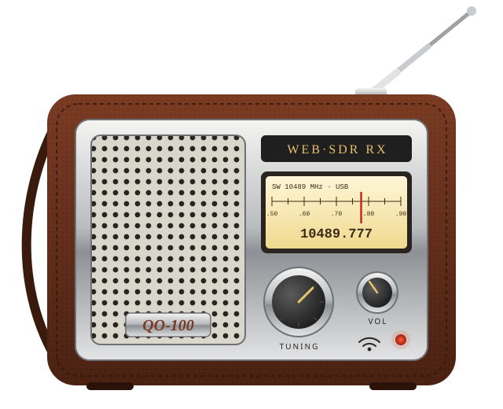
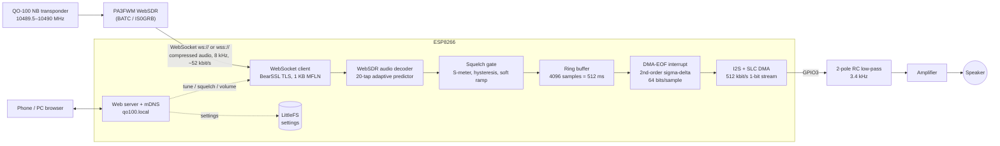

# QO-100 WebSDR Pocket Radio (ESP8266)

**English** · [Türkçe](README.tr.md)

<p align="center"></p>

An ESP8266 that behaves like a little stand-alone shortwave set for the
**QO-100 (Es'hail-2) narrowband transponder**. It connects to a public
PA3FWM WebSDR over WiFi, listens to **10489.777 MHz USB**, and plays the audio
from a single GPIO pin. No PC or phone is needed while it plays. A phone or
PC is only used to tune it through its built-in web page.

- Supported WebSDRs: **BATC / AMSAT-UK** (`eshail.batc.org.uk`, TLS) and **IS0GRB** (`websdr.is0grb.it:8901`)
- Web UI: fine tuning in 10 Hz / 100 Hz / 1 kHz steps, a ±3 kHz slider, direct MHz entry, mute, volume, adjustable squelch, S-meter, server selection
- WiFi setup through a captive portal (`qo100` access point)
- All settings are saved in flash. After power-off the radio starts again on the same frequency, volume, squelch and server.
- Flash it from the browser: **https://barisdinc.github.io/qo100-radio/**

---

## 1. Install the firmware

### a) From the browser (easiest)
1. Open **https://barisdinc.github.io/qo100-radio/** in **Chrome or Edge** on a desktop. Firefox and Safari do not support Web Serial.
2. Connect the ESP8266 board (NodeMCU, Wemos D1 mini or another ESP-12 board with 4 MB flash) with a USB cable.
3. Click **Install**, pick the serial port (`CH340`, `CP210x`…), confirm, and wait about 1 minute.
4. **Unplug the audio filter from the RX pin while flashing** (see [Hardware](#4-hardware)).

### b) With PlatformIO
```bash
python3 -m venv ~/.venvs/pio && ~/.venvs/pio/bin/pip install platformio
~/.venvs/pio/bin/pio run -t upload        # port set in platformio.ini (/dev/ttyUSB0)
~/.venvs/pio/bin/pio device monitor       # log output, 115200 baud
```

## 2. First start: connect it to your WiFi (step by step)

The first time (or whenever the saved network cannot be reached), the radio
creates its **own WiFi access point**:

| | |
|---|---|
| Network name (SSID) | **`qo100`** |
| Password | **`10489777`** |
| Setup page | **http://192.168.4.1** |

1. Power the radio and wait about 25 seconds. During that time it tries the saved network.
2. On your phone or laptop open the WiFi settings and join **`qo100`** with password **`10489777`**.
3. The phone may say *"This network has no internet access"*. Choose **"Stay connected"** / **"Use this network anyway"**.
   On Android it also helps to switch **mobile data off** temporarily, so the browser does not send 192.168.4.1 over 4G.
4. Usually a login/setup page opens by itself (captive portal). If it doesn't, open a browser and go to **http://192.168.4.1**.
5. The page lists the WiFi networks found. **Tap your home network**, type its **password**, and press
   **"Kaydet ve yeniden başlat"** (Save and restart).
6. The radio restarts and joins your network (about 5 s). The `qo100` access point disappears.
   Reconnect your phone to your **home WiFi**.
7. If the password was wrong or the network is out of range, the `qo100` access point comes back after about 25 s. Repeat from step 2.

> If nobody connects to the `qo100` access point for 5 minutes, the radio reboots and tries the saved
> network again. This helps after a power cut when the router boots slower than the radio.

## 3. Using the radio: `http://qo100.local`

With your phone or PC on the **same WiFi as the radio**, open:

- **http://qo100.local**, or
- the radio's **IP address**, for example `http://192.168.1.57`. Use this on **Android**, which usually cannot resolve `.local` names.
  You can find the IP in your router's DHCP client list (device name `qo100`) or in the serial log.

The radio starts playing about 6 seconds after power-on, using the last settings.

| Control | What it does |
|---|---|
| Green/red dot | Green = connected to the WebSDR and receiving audio |
| Frequency display | Current dial frequency (USB) and offset from 10489.777 MHz |
| **-1k -100 -10 +10 +100 +1k** | Step the frequency in Hz. The WebSDR tunes in ~31 Hz steps. |
| **Fine tune slider** | ±3 kHz around 10489.777 MHz. Release the slider to tune. |
| **MHz box + Git** | Type a frequency such as `10489.650` and press *Git* (Go) |
| **Merkez** | Back to 10489.777 MHz |
| **Ses açık / SESSİZ** | Mute / unmute |
| **Ses seviyesi** | Volume |
| **Squelch eşiği** | Audio is cut when the S-meter is below this level. Far left = squelch off. 2 dB hysteresis and 500 ms hang time stop it from chattering. |
| S-meter bar | Signal level. The white marker shows the squelch threshold. |
| **Sunucu squelch** | Also enables the WebSDR's own (server-side) squelch |
| **WebSDR sunucusu** | Choose BATC or IS0GRB |
| Info line | IP, WiFi RSSI, audio buffer fill, underrun counter, free memory |
| **WiFi ayarları** | Change the WiFi network |

Every change is saved to flash 5 seconds later, so the radio comes back exactly as you left it.

## 4. Hardware

```
 GPIO3 (RX) ──[R1]──┬──[R2]──┬──||──> amplifier input (PAM8403 / LM386 module)
                    │        │  1µF
                  [C1]     [C2]
                    │        │
 GND ───────────────┴────────┴──────> amplifier GND
```

| | R1 | C1 | R2 | C2 | Notes |
|---|---|---|---|---|---|
| Original build | 1 kΩ | 47 nF | 4.7 kΩ | 10 nF | Tested. Must be **disconnected while flashing**. |
| Flash-friendly | 4.7 kΩ | 10 nF | 47 kΩ | 1 nF | Same 3.4 kHz corners. Loads the USB-serial RX line much less, so it should stay connected while flashing (not yet tested). |

- Both RC poles are at about **3.4 kHz**. The SSB audio band is 300–2800 Hz.
- The output is a few hundred mV, so use a small amplifier for a speaker.
- Put **470–1000 µF + 100 nF** across the ESP's 3.3 V and GND if you hear WiFi-related buzz.
  The 1-bit output swings between GND and 3.3 V, so supply ripple goes straight into the audio.
- GPIO3 is also the UART RX pin. The firmware opens the serial port in TX-only mode, so logging still works.

## 5. How it works



**WebSDR session.** The radio opens the same audio WebSocket a browser opens
(`/~~stream?v=11`) and sends the same tuning command:
`GET /~~param?f=10489777.000&band=0&lo=0.30&hi=2.80&mode=0`. Frequency is in kHz,
and `mode=0` with a positive `lo`/`hi` passband selects USB. The server answers
with binary messages containing the S-meter, the sample rate and compressed
128-sample audio blocks. If no data arrives for 15 s, or the link drops, the
radio reconnects by itself. BATC needs TLS. The ESP8266 negotiates a 1 KB TLS
record size (MFLN), which keeps BearSSL's memory use at about 3 KB instead of 17 KB.

**Decoding.** Each block is entropy-coded residuals of a 20-tap adaptive
linear predictor. `src/websdr_codec.cpp` decodes them. On a PC it was checked
against a transcription of the reference client and the output is
bit-identical on captured streams from both servers.

**Squelch.** The S-meter value (dB = raw/10 − 127) drives a gate with 2 dB
hysteresis and 500 ms hang time. The gate gain ramps over ~16 ms, so opening
and closing do not click.

**Audio output, and why not plain PWM.** The ESP8266 has no DAC, and
timer-driven PWM jitters badly whenever WiFi interrupts run. Instead, the I2S
peripheral shifts out a **1-bit, 2nd-order sigma-delta** stream at 512 kbit/s
(64 bits per audio sample, with linear interpolation between samples). An RC
low-pass filter turns that bit density back into analog audio. The firmware has
its own small SLC/I2S DMA driver. The DMA buffers are refilled **inside the
DMA-complete interrupt** straight from the 512 ms ring buffer, so audio keeps
flowing even while the main loop is busy with TLS, HTTP or flash writes. If the
network ever stalls, the output holds mid-scale silence instead of dropping to
0 V. The core Arduino I2S driver zero-fills on underflow, which is what caused
clicks in an early version. Small clock differences between the WebSDR and the
ESP8266 are absorbed by occasionally repeating or skipping one sample, which
cannot be heard.

**WiFi.** The radio tries **802.11g first, then 11n**. Some modern 11n/ax
routers never complete the WPA2 handshake with an ESP8266 in 11n mode.
Modem sleep is disabled to avoid audio gaps.

## 6. Troubleshooting

| Symptom | Cause / fix |
|---|---|
| Upload fails: *Failed to connect* / *Invalid head of packet* | The RC filter on GPIO3 loads the RX line. Disconnect it while flashing, or use the flash-friendly values. |
| Phone joins `qo100` but no page | Open http://192.168.4.1 manually. Turn mobile data off. Choose "stay connected". |
| Phone gets no IP from `qo100` | Forget the network and join again. Make sure you are running the current firmware. |
| `qo100.local` does not open | Use the IP address (Android does not resolve mDNS). Check the phone is on the same WiFi. |
| Keeps coming back as `qo100` AP | Wrong password, or the router uses WPA3-only or 5 GHz only. The ESP8266 needs 2.4 GHz WPA2. |
| Hum or ticks | Add decoupling on 3.3 V. Power the amplifier separately. Keep wires short. |
| Silence, dot red | WebSDR unreachable. Try the other server in the menu. |

## 7. Files

| File | Contents |
|---|---|
| `src/main.cpp` | WiFi / captive portal, web server, WebSDR session, squelch |
| `src/websdr_codec.*` | WebSDR audio stream decoder |
| `src/ws_client.*` | Non-blocking ws/wss WebSocket client |
| `src/audio_out.*` | Ring buffer, SLC/I2S DMA driver, sigma-delta modulator |
| `src/web_pages.h` | Web UI pages |
| `src/settings.*` | Settings stored in LittleFS |
| `docs/img/radio.svg` | Illustration |

## 8. License / fair use

The WebSDR audio compression format belongs to PA3FWM's WebSDR software
(pa3fwm@websdr.org). The licence of its client JavaScript does not allow
reverse engineering or reuse without his permission. `src/websdr_codec.cpp`
implements a decoder for that format. Obtain PA3FWM's permission before using
or redistributing it. Please also respect the WebSDR operators (BATC / AMSAT-UK,
IS0GRB): one connection per radio, and don't leave it streaming when nobody
is listening.

73 de TA7W / OH2UDS
