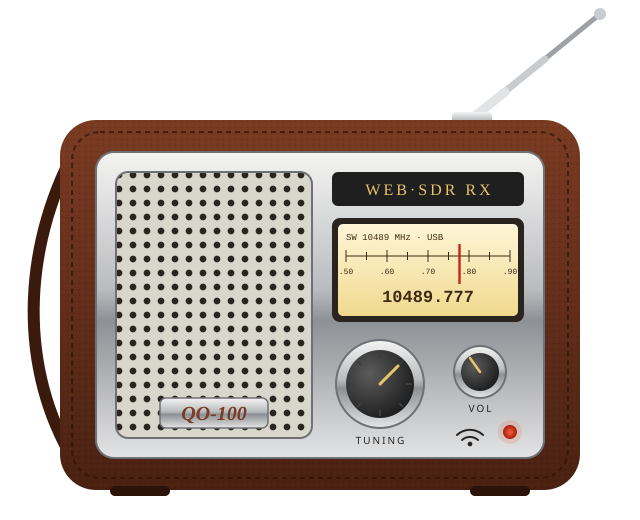
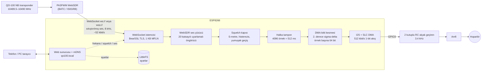

# QO-100 WebSDR Cep Radyosu (ESP8266)

[English](README.md) · **Türkçe**

<p align="center"></p>

**QO-100 (Es'hail-2) dar bant transponderini** dinleyen, tek başına çalışan
küçük bir kısa dalga radyosu gibi davranan bir ESP8266 projesi. WiFi
üzerinden herkese açık bir PA3FWM WebSDR'a bağlanır, **10489.777 MHz USB**
dinler ve sesi tek bir GPIO pininden verir. Çalarken PC ya da telefon
gerekmez. Telefon veya PC yalnızca dahili web sayfasından ayar yapmak için
kullanılır.

- Desteklenen WebSDR'lar: **BATC / AMSAT-UK** (`eshail.batc.org.uk`, TLS) ve **IS0GRB** (`websdr.is0grb.it:8901`)
- Web arayüzü: 10 Hz / 100 Hz / 1 kHz adımlarla ince ayar, ±3 kHz kaydırıcı, MHz girişi, sessiz, ses seviyesi, ayarlanabilir squelch, S-metre, sunucu seçimi
- Captive portal ile WiFi kurulumu (`qo100` erişim noktası)
- Tüm ayarlar flash'a kaydedilir. Kapatıp açınca radyo aynı frekans, ses seviyesi, squelch ve sunucuyla başlar.
- Tarayıcıdan yükleme: **https://barisdinc.github.io/qo100-radio/**

---

## 1. Firmware'i yükleme

### a) Tarayıcıdan (en kolayı)
1. Bilgisayarda **Chrome veya Edge** ile **https://barisdinc.github.io/qo100-radio/** adresini açın. Firefox ve Safari Web Serial desteklemez.
2. ESP8266 kartını (NodeMCU, Wemos D1 mini veya 4 MB flash'lı başka bir ESP-12 kartı) USB kablosuyla bağlayın.
3. **Install** düğmesine basın, seri portu (`CH340`, `CP210x`…) seçin, onaylayın ve yaklaşık 1 dakika bekleyin.
4. **Yükleme sırasında RX pinindeki ses filtresini ayırın** (bkz. [Donanım](#4-donanım)).

### b) PlatformIO ile
```bash
python3 -m venv ~/.venvs/pio && ~/.venvs/pio/bin/pip install platformio
~/.venvs/pio/bin/pio run -t upload        # port platformio.ini içinde (/dev/ttyUSB0)
~/.venvs/pio/bin/pio device monitor       # log çıktısı, 115200 baud
```

## 2. İlk açılış: WiFi'ye bağlama (adım adım)

İlk açılışta (ya da kayıtlı ağa ulaşılamadığında) radyo **kendi WiFi erişim
noktasını** açar:

| | |
|---|---|
| Ağ adı (SSID) | **`qo100`** |
| Şifre | **`10489777`** |
| Kurulum sayfası | **http://192.168.4.1** |

1. Radyoya güç verin ve yaklaşık 25 saniye bekleyin. Bu sürede kayıtlı ağı dener.
2. Telefonda ya da dizüstünde WiFi ayarlarını açın ve **`qo100`** ağına **`10489777`** şifresiyle bağlanın.
3. Telefon *"Bu ağın internet erişimi yok"* diyebilir. **"Bağlı kal"** / **"Yine de bu ağı kullan"** seçin.
   Android'de **mobil veriyi** geçici olarak kapatmak da işe yarar, böylece tarayıcı 192.168.4.1'i 4G üzerinden aramaz.
4. Kurulum sayfası genelde kendiliğinden açılır (captive portal). Açılmazsa tarayıcıda **http://192.168.4.1** adresine gidin.
5. Sayfada bulunan WiFi ağları listelenir. **Ev ağınıza dokunun**, **şifresini** yazın ve
   **"Kaydet ve yeniden başlat"** düğmesine basın. Ağ listede yoksa adını elle yazın; büyük/küçük harf önemlidir.
6. Radyo yeniden başlar ve ağınıza bağlanır (yaklaşık 5 sn). `qo100` erişim noktası kaybolur.
   Telefonunuzu tekrar **ev WiFi'nize** bağlayın.
7. Şifre yanlışsa ya da ağ menzil dışındaysa yaklaşık 25 sn sonra `qo100` erişim noktası yeniden açılır. 2. adımdan tekrarlayın.

> `qo100` erişim noktasına 5 dakika boyunca kimse bağlanmazsa radyo yeniden başlar ve kayıtlı ağı
> tekrar dener. Elektrik kesintisinden sonra modem radyodan geç açıldığında bu işe yarar.

## 3. Radyoyu kullanma: `http://qo100.local`

Telefon veya PC **radyoyla aynı WiFi ağındayken** şu adreslerden birini açın:

- **http://qo100.local**, ya da
- radyonun **IP adresi**, örneğin `http://192.168.1.57`. **Android**'de bunu kullanın, çünkü Android genelde `.local` adlarını çözemez.
  IP'yi modemin DHCP listesinde (cihaz adı `qo100`) ya da seri logda bulabilirsiniz.

Radyo, açıldıktan yaklaşık 6 saniye sonra son ayarlarla çalmaya başlar.

| Kontrol | İşlevi |
|---|---|
| Yeşil/kırmızı nokta | Yeşil = WebSDR'a bağlı, ses geliyor |
| Frekans göstergesi | Geçerli frekans (USB) ve 10489.777 MHz'e göre fark |
| **-1k -100 -10 +10 +100 +1k** | Frekansı Hz cinsinden adım adım değiştirir. WebSDR yaklaşık 31 Hz'lik adımlarla ayarlar. |
| **İnce ayar kaydırıcısı** | 10489.777 MHz etrafında ±3 kHz. Kaydırıcıyı bırakınca frekans ayarlanır. |
| **MHz kutusu + Git** | `10489.650` gibi bir frekans yazıp *Git*'e basın |
| **Merkez** | 10489.777 MHz'e döner |
| **Ses açık / SESSİZ** | Sesi kapatır / açar |
| **Ses seviyesi** | Ses seviyesi |
| **Squelch eşiği** | S-metre bu seviyenin altındayken ses kesilir. En sol = squelch kapalı. 2 dB histerezis ve 500 ms bekleme süresi sayesinde açılıp kapanma titremesi olmaz. |
| S-metre çubuğu | Sinyal seviyesi. Beyaz çizgi squelch eşiğini gösterir. |
| **Sunucu squelch** | WebSDR'ın kendi (sunucu taraflı) squelch'ini de açar |
| **WebSDR sunucusu** | BATC ya da IS0GRB seçimi |
| Bilgi satırı | IP, WiFi RSSI, ses tamponu doluluğu, boşalma sayacı, boş bellek |
| **WiFi ayarları** | WiFi ağını değiştirme |

Her değişiklik 5 saniye sonra flash'a kaydedilir. Radyo, bıraktığınız haliyle geri açılır.

## 4. Donanım

```
 GPIO3 (RX) ──[R1]──┬──[R2]──┬──||──> amfi girişi (PAM8403 / LM386 modülü)
                    │        │  1µF
                  [C1]     [C2]
                    │        │
 GND ───────────────┴────────┴──────> amfi GND
```

| | R1 | C1 | R2 | C2 | Not |
|---|---|---|---|---|---|
| İlk yapılan | 1 kΩ | 47 nF | 4.7 kΩ | 10 nF | Test edildi. **Yükleme sırasında ayrılmalı.** |
| Yüklemeye uygun | 4.7 kΩ | 10 nF | 47 kΩ | 1 nF | Aynı 3.4 kHz kesim. USB-seri RX hattını çok daha az yükler, yüklemede takılı kalabilmeli (henüz test edilmedi). |

- Her iki RC kutbu da yaklaşık **3.4 kHz**'te. SSB ses bandı 300–2800 Hz.
- Çıkış birkaç yüz mV seviyesindedir. Hoparlör için küçük bir amfi kullanın.
- WiFi kaynaklı vızıltı duyarsanız ESP'nin 3.3 V ile GND bacakları arasına **470–1000 µF + 100 nF** koyun.
  1-bit çıkış GND ile 3.3 V arasında anahtarlandığı için besleme dalgalanması doğrudan sese geçer.
- GPIO3 aynı zamanda UART RX pinidir. Firmware seri portu yalnızca TX modunda açar, log çıktısı yine çalışır.

## 5. Çalışma mantığı



**WebSDR oturumu.** Radyo, bir tarayıcının açtığı ses WebSocket'inin
(`/~~stream?v=11`) aynısını açar ve aynı ayar komutunu gönderir:
`GET /~~param?f=10489777.000&band=0&lo=0.30&hi=2.80&mode=0`. Frekans kHz
cinsindendir; `mode=0` ile pozitif `lo`/`hi` geçiş bandı USB'yi seçer. Sunucu
S-metre, örnekleme hızı ve sıkıştırılmış 128 örneklik ses bloklarından oluşan
ikili mesajlarla yanıt verir. 15 sn veri gelmezse ya da bağlantı koparsa radyo
kendiliğinden yeniden bağlanır. BATC TLS gerektirir. ESP8266, 1 KB'lık TLS
kayıt boyutu (MFLN) anlaşması yapar; böylece BearSSL 17 KB yerine yaklaşık
3 KB bellek kullanır.

**Çözme.** Her blok, 20 katsayılı uyarlamalı doğrusal öngörücünün entropi
kodlanmış artıklarından oluşur. `src/websdr_codec.cpp` bunları çözer. PC'de,
referans istemcinin birebir aktarımıyla karşılaştırıldı; iki sunucudan
yakalanan akışlarda çıktı bit düzeyinde aynı.

**Squelch.** S-metre değeri (dB = ham/10 − 127), 2 dB histerezisli ve 500 ms
bekleme süreli bir kapıyı sürer. Kapı kazancı yaklaşık 16 ms'de yumuşakça
değiştiği için açılıp kapanırken tık sesi olmaz.

**Ses çıkışı ve neden düz PWM değil.** ESP8266'da DAC yoktur. Zamanlayıcıyla
üretilen PWM de WiFi kesmeleri çalıştığında ciddi jitter yapar. Bunun yerine
I2S birimi 512 kbit/s hızında **1-bit, 2. derece sigma-delta** akış üretir
(ses örneği başına 64 bit, örnekler arasında doğrusal ara değerleme). RC alçak
geçiren filtre bu bit yoğunluğunu yeniden analog sese çevirir. Firmware'in
kendi küçük SLC/I2S DMA sürücüsü vardır. DMA tamponları **DMA-bitti kesmesinin
içinde**, doğrudan 512 ms'lik halka tampondan doldurulur. Bu yüzden ana döngü
TLS, HTTP ya da flash yazma ile meşgulken bile ses akmaya devam eder. Ağ bir an
takılırsa çıkış 0 V'a düşmek yerine orta seviyede sessiz kalır. Arduino
core'unun I2S sürücüsü boşalma anında tamponu sıfırla dolduruyordu; ilk
sürümdeki tıkırtıların sebebi buydu. WebSDR ile ESP8266 arasındaki küçük saat
farkı, arada bir örneği tekrarlayarak ya da atlayarak dengelenir; bu kulakla
duyulmaz.

**WiFi.** Radyo **önce 802.11g, sonra 11n** dener. Bazı yeni 11n/ax router'lar
11n modundaki ESP8266 ile WPA2 el sıkışmasını hiç tamamlamaz. Ses boşluklarını
önlemek için modem uyku modu kapalıdır.

## 6. Sorun giderme

| Belirti | Sebep / çözüm |
|---|---|
| Yükleme başarısız: *Failed to connect* / *Invalid head of packet* | GPIO3'teki RC filtre RX hattını yüklüyor. Yükleme sırasında ayırın ya da yüklemeye uygun değerleri kullanın. |
| Telefon `qo100`'e bağlanıyor ama sayfa açılmıyor | http://192.168.4.1 adresini elle açın. Mobil veriyi kapatın. "Bağlı kal" seçin. |
| Telefon `qo100`'den IP alamıyor | Ağı unutup yeniden bağlanın. Güncel firmware'in yüklü olduğundan emin olun. |
| `qo100.local` açılmıyor | IP adresini kullanın (Android mDNS çözmez). Telefonun aynı WiFi'de olduğunu kontrol edin. |
| Sürekli `qo100` AP'si olarak açılıyor | Şifre yanlış, ya da router yalnızca WPA3 veya yalnızca 5 GHz kullanıyor. ESP8266 2.4 GHz WPA2 ister. |
| Vızıltı ya da tıkırtı | 3.3 V'a dekuplaj kondansatörü ekleyin. Amfiyi ayrı besleyin. Kabloları kısa tutun. |
| Ses yok, nokta kırmızı | WebSDR'a ulaşılamıyor. Menüden diğer sunucuyu deneyin. |

## 7. Dosyalar

| Dosya | İçerik |
|---|---|
| `src/main.cpp` | WiFi / captive portal, web sunucusu, WebSDR oturumu, squelch |
| `src/websdr_codec.*` | WebSDR ses akışı çözücüsü |
| `src/ws_client.*` | Bloklamayan ws/wss WebSocket istemcisi |
| `src/audio_out.*` | Halka tampon, SLC/I2S DMA sürücüsü, sigma-delta modülatör |
| `src/web_pages.h` | Web arayüzü sayfaları |
| `src/settings.*` | LittleFS'te saklanan ayarlar |
| `docs/img/radio.svg` | Çizim |

## 8. Lisans / adil kullanım

WebSDR ses sıkıştırma formatı PA3FWM'nin WebSDR yazılımına aittir
(pa3fwm@websdr.org). İstemci JavaScript'inin lisansı, onun izni olmadan tersine
mühendisliğe ve yeniden kullanıma izin vermez. `src/websdr_codec.cpp` bu format
için bir çözücüdür. Kullanmadan ya da dağıtmadan önce PA3FWM'den izin alın.
WebSDR işletmecilerine de (BATC / AMSAT-UK, IS0GRB) saygı gösterin: radyo başına
tek bağlantı açın ve kimse dinlemiyorken sürekli yayın çekmeyin.

73 de TA7W / OH2UDS
